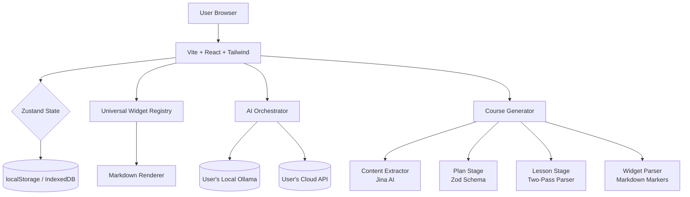

# 🚧 Interactive Roadmaps

> **An open-source, interactive, zero-backend learning platform for Software Engineering, AI, and System Design — with AI-powered course generation.**

[]()
[]()
[](https://interactive-roadmaps.pages.dev/)
[](https://interactive-roadmaps.pages.dev/)
[]()

> ### 🌐 [**→ Try the Live Demo**](https://interactive-roadmaps.pages.dev/)
> Experience the platform in your browser — no installation required. Connect your own Ollama or API key in Settings to unlock the AI Tutor and Course Generator.

---

## 💡 Why This Project?

Traditional learning platforms treat you like a passive consumer. Watch a video. Read a tutorial. Copy code.

**We believe you learn by doing.** That's why every lesson is interactive. Every concept has a sandbox. Every question gets a Socratic tutor that guides you — never gives you the answer.

And because we use your own compute (local Ollama or your API keys), we have no server costs, no vendor lock-in, and no privacy concerns.

---

## 🎯 The Vision

Most technical learning platforms suffer from one of two problems:
1. **They're passive** — long videos, walls of text, and zero hands-on practice.
2. **They're expensive** — running code in the cloud requires massive backend infrastructure that costs thousands per month.

**Interactive Roadmaps** solves both. It's a 100% client-side, interactive learning platform where you learn by *doing* — using your own local LLM (Ollama) or Cloud API keys.

---

## ✨ Key Features

### 🏗️ Core Engine
- **Zero-Backend Architecture** — Hosted entirely on Cloudflare Pages ([live demo](https://interactive-roadmaps.pages.dev/)). All state managed locally via Zustand and IndexedDB.
- **Bring Your Own Compute (BYOK)** — Connect your own OpenAI, Groq, or local Ollama instance. No API keys stored on our servers.
- **Offline-First Design** — Works without an internet connection once loaded (with local Ollama).

### 🧩 Universal Widget Engine
Instead of building 100 domain-specific UIs, we built **5 universal interaction primitives** that work across ANY roadmap:

| Widget | What It Does | Example Use Cases |
|--------|--------------|-------------------|
| **Sandbox** | Input → Process → Output | Prompt testing, HTML rendering, API exploration |
| **Mutator** | Fix broken code with hidden tests | Debugging Python, fixing SQL, correcting YAML |
| **NodeGraph** | Drag-and-drop pipeline builder | RAG pipelines, CI/CD flows, microservice routing |
| **TradeOff** | Decision matrix with consequences | SQL vs NoSQL, latency vs cost, architecture choices |
| **SocraticChat** | AI tutor that guides, never answers | Universal tutoring across all lessons |

### 🧠 AI-Powered Learning
- **Socratic Tutor** — Built-in chat with an "Anti-Cheat" system prompt. The AI *guides* you to answers, never gives them away.
- **Prompt Library** — 10+ pre-built prompt starters to eliminate blank-canvas paralysis.

### 🎓 AI Course Generator
Turn any article, documentation page, or roadmap into a personalized interactive course — directly in your browser.

- **Multi-Stage Pipeline** — Analyze → Plan → Generate → Validate → Assemble. Each stage has its own validation and retry logic.
- **Plan Review Checkpoint** — Inspect and edit the generated course plan (rename lessons, reorder, delete) before lesson content is generated.
- **Single Lesson Regeneration** — Regenerate a single weak lesson without re-running the entire course.
- **Progressive Difficulty** — The planner assigns difficulty levels (`beginner` → `intermediate` → `advanced`) so lessons build up naturally.
- **Two Generation Modes:**
  - **Focused Content** (default) — AI writes natural markdown with simple `:::widget` markers. Your code deterministically builds the JSON. Works reliably with **any model**, including weak/small local models.
  - **Structured JSON** — AI outputs nested JSON directly. Faster, but needs strong models (GPT-4, Claude, etc.).
- **Pedagogical Prompts** — Lessons follow a `WHAT → WHY → HOW` structure with analogies, concrete examples, and jargon definitions. First lessons explicitly assume no prior knowledge.
- **Smart Content Truncation** — When source content exceeds the context window, truncation falls back progressively through section → paragraph → sentence → word boundaries to preserve meaning.
- **Coherent Lessons** — Each lesson receives key concepts, difficulty, and widget types from all previous lessons so the AI can build on prior knowledge instead of repeating it.

### 📦 Smart Content Architecture
- **Module-Level Bundling** — Lessons are grouped by module to bypass Cloudflare's 20k file limit and enable infinite scalability.
- **Runtime Markdown Rendering** — Static core and dynamically generated courses use the exact same rendering engine.
- **Custom Visualizer Escape Hatch** — For the 5% of lessons needing highly-specific animations (e.g., TCP/IP handshakes).

---

## 🗺️ Roadmaps (Planned)

| Roadmap | Status | Description |
|---------|--------|-------------|
| **Software Engineering** | 🟡 In Progress | Programming fundamentals, data structures, algorithms |
| **AI Engineer** | 🔴 Planned | LLMs, RAG, Agents, Prompt Engineering, Evaluation |
| **System Design** | 🔴 Planned | Load balancers, caching, databases, scalability |
| **Backend** | 🔴 Planned | APIs, microservices, message queues, security |
| **Frontend** | 🔴 Planned | React, state management, performance, accessibility |

---

## 📁 Project Structure

```
src/
├── components/
│   ├── core/          # SettingsModal, MarkdownRenderer
│   ├── layout/        # Header, Sidebar
│   └── universal/     # Widget components (Sandbox, Mutator, NodeGraph, TradeOff, SocraticChat)
├── engine/            # Core logic
│   ├── aiService.ts         # Unified adapter for OpenAI/Groq/Ollama
│   ├── courseGenerator.ts   # Multi-stage generation pipeline
│   ├── lessonParser.ts      # Two-pass parser (markdown + widget markers → lesson JSON)
│   ├── generatorSchema.ts   # Zod schemas + prompts for plan & lesson generation
│   ├── extractor.ts         # URL → markdown (via Jina AI)
│   ├── settings.ts          # AISettings store
│   ├── registry.ts          # Widget registry
│   ├── progress.ts          # Generation progress tracking
│   ├── chatHistory.ts       # Socratic chat history
│   └── contextManager.ts    # Lesson context manager
├── curriculum/        # DAG data model and graph utilities
├── data/              # Prompt library, static content
├── hooks/             # Custom React hooks (useAIStream, etc.)
└── pages/             # Route components (Lesson, Home, CourseGenerator)
```

---

## 🏗️ Architecture



### Tech Stack
- **Framework:** Vite + React 18 + TypeScript (Strict Mode)
- **Styling:** Tailwind CSS + shadcn/ui
- **State:** Zustand (persisted to localStorage/IndexedDB)
- **Routing:** React Router
- **Content:** react-markdown + rehype-raw
- **Code Editor:** Monaco Editor
- **Storage:** Dexie (IndexedDB wrapper) for generated courses
- **Validation:** Zod schemas for all AI-generated content
- **Testing:** Vitest + React Testing Library (230+ tests)
- **Hosting:** Cloudflare Pages ([live demo](https://interactive-roadmaps.pages.dev/))

---

## 🚀 Getting Started

### Prerequisites
- Node.js 18+
- npm or yarn
- (Optional) [Ollama](https://ollama.com/) for local AI

### Installation

```bash
# Clone the repository
git clone https://github.com/alshamali-tech/interactive-roadmaps.git
cd interactive-roadmaps

# Install dependencies
npm install

# Start the development server
npm run dev
```

Open [http://localhost:5173](http://localhost:5173) in your browser.

> 💡 **Don't want to install anything?** Try the [live demo](https://interactive-roadmaps.pages.dev/) instead — it's the same codebase running on Cloudflare Pages.

### Connecting Your AI

This project uses a **Bring Your Own Key (BYOK)** model. You have two options:

#### Option 1: Local Ollama (Recommended for Privacy)
```bash
# Install Ollama from https://ollama.com
# Pull a model
ollama pull llama3

# Start Ollama with CORS enabled (CRITICAL for browser access)
$env:OLLAMA_ORIGINS="*"; ollama serve  # Windows PowerShell
# OLLAMA_ORIGINS="*" ollama serve      # macOS/Linux
```

Then in the app, go to **Settings → Local Ollama** and use:
- Base URL: `http://localhost:11434/v1`
- Model: `llama3` (or whatever model you pulled)

#### Option 2: Cloud API
Get an API key from [OpenAI](https://platform.openai.com/), [Groq](https://console.groq.com/), or [Anthropic](https://console.anthropic.com/).

Then in the app, go to **Settings → Cloud Providers** and enter your key.

### Choosing a Generation Mode

In **Settings**, you'll find **Content Generation Mode** with two options:

| Mode | Best For | How It Works |
|------|----------|--------------|
| **Focused Content** (default) | Any model, including weak/local models | AI writes natural markdown with `:::widget` markers. Your code deterministically parses into structured JSON. |
| **Structured JSON** | Strong models (GPT-4, Claude, etc.) | AI outputs nested JSON directly. Faster but fragile with weak models. |

---

## 🔒 Security

- **API Keys:** Stored only in your browser's localStorage. Never sent to our servers.
- **Local Ollama:** All inference happens on your machine. Zero data leaves your computer.
- **Cloud APIs:** Keys are sent directly from your browser to OpenAI/Groq. We never see them.
- **Generated Courses:** Stored in your browser's IndexedDB. Portable via export.

---

## ⚡ Performance

- **Bundle Size:** Optimized with Vite code-splitting and lazy-loaded widgets.
- **Offline Support:** Service worker caches all static assets for instant reloads.
- **First Load:** < 2s on 4G connection.

---

## 🛠️ Troubleshooting

### Ollama Connection Fails
If you see "Cannot connect to AI" or "404 model not found" errors:
1. Make sure Ollama is running: `ollama serve`
2. **Critical:** Start with CORS enabled: `$env:OLLAMA_ORIGINS="*"; ollama serve` (Windows) or `OLLAMA_ORIGINS="*" ollama serve` (Mac/Linux)
3. Verify the model exists: `ollama list`
4. Check the model name matches exactly (e.g., `llama3` not `llama-3`)

### Course Generation Fails
- **Weak model producing invalid JSON?** Switch to **Focused Content** mode in Settings — it uses markdown with widget markers instead of JSON.
- **"Failed to parse JSON" errors?** This is exactly what Focused mode solves. The parser is deterministic and never fails.
- **Empty or thin content?** Try a stronger model, or increase the token limit in your API provider settings.
- **Trade-off widget shows "Unknown widget type"?** Make sure you're on the latest version — this bug was fixed in a recent update.

### API Key Not Saving
- Check browser console for errors
- Ensure localStorage is not blocked by browser settings (e.g., incognito mode)
- Try clearing site data and re-entering the key

---

## 🧪 Testing

```bash
# Run tests in watch mode
npm run test

# Run tests with coverage
npm run test -- --coverage
```

We use **Vitest** for unit tests and **React Testing Library** for component tests. Our testing strategy:
- **Test-First** for core logic (Zustand stores, Zod schemas, utility functions)
- **Test-After** for UI components (smoke tests to ensure nothing crashes)
- **Integration tests** for the course generation pipeline (plan → lesson → widget parsing)

---

## 🗓️ Development Roadmap

### ✅ Phase 1: Foundation & Core Engine
- [x] Vite + React + TypeScript setup
- [x] Tailwind CSS + shadcn/ui configuration
- [x] Zustand state management with localStorage persistence
- [x] React Router setup
- [x] DAG curriculum data model (Track → Module → Lesson)

### ✅ Phase 2: Universal Widget Engine
- [x] Widget Registry system
- [x] Sandbox widget
- [x] Mutator widget (with Monaco Editor)
- [x] NodeGraph widget (with React Flow)
- [x] TradeOff widget (with Recharts)
- [x] SocraticChat widget with Prompt Library
- [x] Custom Visualizer escape hatch

### ✅ Phase 3: AI Orchestrator & BYOK
- [x] Settings modal for API keys / Ollama config
- [x] Unified AI service adapter (OpenAI/Groq/Ollama)
- [x] SSE streaming hook
- [x] Anti-Cheat system prompt
- [x] No-AI fallback state
- [x] Connect SocraticChat to real AI

### ✅ Phase 4: Static Core & Content Rendering
- [x] Markdown rendering engine with syntax highlighting
- [x] Widget injection parser (`<widget>` tags → components)
- [x] Content bundling system
- [x] First module: Software Engineering Foundations

### ✅ Phase 5: Dynamic Course Generator
- [x] URL/text extraction service (Jina AI)
- [x] Zod schemas for plan + lesson responses
- [x] Multi-stage pipeline: Extract → Plan → Lesson → Widget → Validate
- [x] Plan review UI (edit, reorder, delete, regenerate)
- [x] Single lesson regeneration
- [x] Progressive difficulty planning
- [x] Two-pass generation (Focused mode for weak models, Structured for strong)
- [x] IndexedDB storage for generated courses
- [x] Coherence context (previous lessons fed into each new lesson)
- [x] Smart content truncation (section → paragraph → sentence → word fallback)
- [x] Pedagogical prompts (WHAT → WHY → HOW, analogies, no-jargon rule)

### 🟡 Phase 6: Content Quality & Polish (In Progress)
- [ ] Course export/import (JSON)
- [ ] Course progress tracking
- [ ] Better widget generation (richer sandbox processFunctions)
- [ ] Human review workflow for generated courses
- [ ] First complete roadmap (Software Engineering)

### 🔴 Phase 7: Production Hardening
- [ ] Mobile responsiveness polish
- [ ] React Error Boundaries
- [ ] SEO meta tags
- [ ] Performance optimization (code splitting, lazy loading)
- [ ] Accessibility audit (WCAG 2.1 AA)

---

## 🤝 Contributing

This project is in active development. We welcome contributions!

### How to Contribute
1. Check the [Issues](../../issues) tab for "good first issue" labels
2. Fork the repository
3. Create a feature branch: `git checkout -b feature/amazing-feature`
4. Commit your changes: `git commit -m 'Add amazing feature'`
5. Push to the branch: `git push origin feature/amazing-feature`
6. Open a Pull Request

### Adding New Widgets
Want to add a new universal widget? See `src/engine/registry.ts` for the interface. All widgets must:
- Accept JSON props (no hardcoded data)
- Be domain-agnostic (work for AI, Backend, Frontend, etc.)
- Include unit tests
- Be registered in `src/engine/registry.ts`
- Be added to the generator schema in `src/engine/generatorSchema.ts`

### Adding New Roadmaps
Want to add a new roadmap (e.g., DevOps, Data Science)? Create a new module bundle in `src/content/` and update `src/curriculum/graph.ts`.

---

## 📄 License

This project is licensed under the MIT License - see the [LICENSE](LICENSE) file for details.

---

## 🙏 Acknowledgments

- [roadmap.sh](https://roadmap.sh/) — Inspiration for the visual roadmap structure
- [shadcn/ui](https://ui.shadcn.com/) — Beautiful, accessible UI components
- [Vite](https://vitejs.dev/) — Lightning-fast build tool
- [React Flow](https://reactflow.dev/) — Node-based UI library
- [Ollama](https://ollama.com/) — Run LLMs locally
- [Jina AI](https://jina.ai/) — URL-to-markdown extraction

---

## 📞 Contact

- **GitHub Issues:** [Report a bug or request a feature](../../issues)
- **Discussions:** [Ask a question or share ideas](../../discussions)

---

<div align="center">

**Built with ❤️ for developers who learn by doing.**

⭐ Star this repo if you find it useful!

</div>
