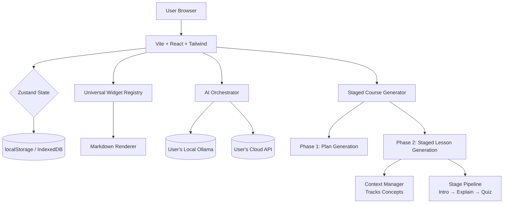

# 🚧 Interactive Roadmaps

> **An open-source, interactive, zero-backend learning platform for Software Engineering, AI, and System Design — with AI-powered, staged course generation.**

### 🌐 [→ Try the Live Demo](https://interactive-roadmaps.pages.dev/)
Experience the platform in your browser — no installation required. Connect your own Ollama or API key in Settings to unlock the AI Tutor and Course Generator.

---

## 💡 Why This Project?

Traditional learning platforms treat you like a passive consumer. Watch a video. Read a tutorial. Copy code.

**We believe you learn by doing.** That's why every lesson is interactive. Every concept has a sandbox. Every question gets a Socratic tutor that guides you — never gives you the answer.

And because we use your own compute (local Ollama or your API keys), we have no server costs, no vendor lock-in, and no privacy concerns.

---

## ✨ Key Features

### 🏗️ Core Engine
- **Zero-Backend Architecture** — Hosted entirely on Cloudflare Pages. All state managed locally via Zustand and IndexedDB.
- **Bring Your Own Compute (BYOK)** — Connect your own OpenAI, Groq, or local Ollama instance. No API keys stored on our servers.
- **Offline-First Design** — Works without an internet connection once loaded (with local Ollama).

### 🧩 Universal Widget Engine
Instead of building 100 domain-specific UIs, we built **5 universal interaction primitives** that work across ANY roadmap:

| Widget | What It Does | Example Use Cases |
| :--- | :--- | :--- |
| **Sandbox** | Input → Process → Output (with Token Counting) | Prompt A/B testing, HTML rendering, API exploration |
| **Mutator** | Fix broken code with hidden tests & progressive hints | Debugging Python, fixing SQL, correcting YAML |
| **Context Diagram** | AI-generated flow/architecture visualizer | RAG pipelines, System Design flows, Sequence diagrams |
| **TradeOff** | Decision matrix with scenario consequences & justification | SQL vs NoSQL, latency vs cost, architecture choices |
| **SocraticChat** | AI tutor with **Tutor / Interview / Challenge** modes | Guided learning, mock interviews, quick knowledge checks |

### 🧠 AI-Powered Learning
- **Socratic Tutor** — Built-in chat with an "Anti-Cheat" system prompt. The AI *guides* you to answers, never gives them away.
- **Interview Mode** — Turns the chat into a progressive technical interview with scoring and feedback.
- **Prompt Library** — 10+ pre-built prompt starters to eliminate blank-canvas paralysis.

### 🎓 AI Course Generator (Staged Pipeline)
Turn any article, documentation page, or roadmap into a personalized interactive course — directly in your browser.

- **Two-Phase Generation** — Interactive Plan Review (user edits the syllabus) → Staged Lesson Generation.
- **Staged Lesson Generation** — Lessons can be generated in atomic stages (Introduction → Motivation → Explanation → Example → Widgets → Quiz → Summary → Review) with per-stage validation and one retry, so quality holds up even on weak local models. Stage count adapts to the detected model tier (S6). **Status:** implemented and integrated, but opt-in — enable it under Settings → Lesson Generation Pipeline (`useStagedGeneration`); it is off by default and any lesson whose staged run fails falls back automatically to the single-pass generator.
- **Concept Registry & Anti-Repetition** — `src/engine/stageContext.ts` tracks concepts introduced per stage and per course, word budgets, established terminology and an anti-repetition list; `stageValidators.ts` flags text that re-defines something already taught. **Status:** enforced inside the staged pipeline (opt-in). With the flag off, cross-lesson coherence is still prompt-level instruction only.
- **Model-Aware Adaptation** — Automatically adjusts stage complexity and widget availability based on whether you are using a weak local model (7B) or a strong cloud model (GPT-4/Claude).
- **Coherent Context Passing** — Each stage receives a structured context summary of previous stages to ensure narrative flow.

### 🏭 MCP-Powered Content Engine (For Maintainers)
- **Cyborg Workflow** — We use the **Model Context Protocol (MCP)** to connect local AI agents (like Qwen/Claude Desktop) directly to the filesystem.
- **Automated Drafting** — The AI reads `docs/MCP_INSTRUCTIONS.md`, drafts lessons, validates them against the Zod schemas through the terminal, and appends them to module bundles. No custom CLI scripts to maintain.

---

## 🗺️ Roadmaps (Planned)

| Roadmap | Status | Description |
| :--- | :--- | :--- |
| **Software Engineering** | 🟡 In Progress | Programming fundamentals, data structures, algorithms |
| **AI Engineer** | 🔴 Planned | LLMs, RAG, Agents, Prompt Engineering, Evaluation |
| **System Design** | 🔴 Planned | Load balancers, caching, databases, scalability |
| **Backend** | 🔴 Planned | APIs, microservices, message queues, security |
| **Frontend** | 🔴 Planned | React, state management, performance, accessibility |

---

## 📁 Project Structure

```text
src/
├── components/
│   ├── core/          # SettingsModal, MarkdownRenderer, FloatingAITutor
│   ├── layout/        # Header, Sidebar
│   └── universal/     # Widget components (Sandbox, Mutator, ContextDiagram, TradeOff, SocraticChat)
├── engine/            # Core logic
│   ├── aiService.ts         # Unified adapter for OpenAI/Groq/Ollama
│   ├── courseGenerator.ts   # Two-phase generation orchestrator
│   ├── diagramGenerator.ts  # Staged diagram pipeline (text → JSON → merge)
│   ├── diagramPrompts.ts    # Per-stage diagram prompts + retry variants
│   ├── stageContext.ts      # S3 stage/course concept + budget + terminology tracker
│   ├── stagePrompts.ts      # S2 per-stage prompt templates + retry variants
│   ├── stageValidators.ts   # S4 per-stage output validation (tier-tolerant)
│   ├── stageAssembler.ts    # S5 merges stage output into a GeneratedLesson
│   ├── stagePipeline.ts     # S1 staged lesson generation orchestrator
│   ├── modelCapability.ts   # S6 model tier detection + tier configs
│   ├── generationHistory.ts # S8 IndexedDB stage journal for resume
│   ├── contextManager.ts    # Chat context-window trimming for conversations
│   ├── lessonParser.ts      # Two-pass parser (markdown + widget markers → JSON)
│   ├── generatorSchema.ts   # Zod schemas for plans, lessons, and widgets
│   └── registry.ts          # Universal widget registry
├── lib/               # Shared helpers (cn, diagramLayout auto-positioning)
├── curriculum/        # DAG data model and graph utilities
├── data/              # Prompt library, static content
├── hooks/             # Custom React hooks (useAIStream, useAIContext)
└── pages/             # Route components (Lesson, Home, CourseGenerator)

docs/MCP_INSTRUCTIONS.md # The "Brain" file for the MCP Content Factory
```

---

## 🏗️ Architecture



### Tech Stack
- **Framework:** Vite + React 18 + TypeScript (Strict Mode)
- **Styling:** Tailwind CSS + shadcn/ui
- **State:** Zustand (persisted to localStorage/IndexedDB)
- **Routing:** React Router
- **Content:** react-markdown + rehype-raw + rehype-highlight
- **Code Editor:** Monaco Editor
- **Storage:** Dexie (IndexedDB wrapper) for generated courses
- **Validation:** Zod schemas for all AI-generated content and stages
- **Testing:** Vitest + React Testing Library (230+ tests)
- **Hosting:** Cloudflare Pages

---

## 🚀 Getting Started

### Prerequisites
- Node.js 18+
- npm or yarn
- (Optional) Ollama for local AI

### Installation

```bash
# Clone the repository
git clone https://github.com/alshamali-tech/interactive-roadmaps.git
cd interactive-roadmaps

# Install dependencies
npm install

# Start the development server
npm run dev
```

Open [http://localhost:5173](http://localhost:5173) in your browser.

### Connecting Your AI

This project uses a **Bring Your Own Key (BYOK)** model. 

#### Option 1: Local Ollama (Recommended for Privacy)
```bash
# Install Ollama from https://ollama.com
ollama pull llama3

# Start Ollama with CORS enabled (CRITICAL for browser access)
# Windows PowerShell:
$env:OLLAMA_ORIGINS="*"; ollama serve
# macOS/Linux:
OLLAMA_ORIGINS="*" ollama serve
```
Then in the app, go to **Settings → Local Ollama** and use Base URL: `http://localhost:11434/v1`.

#### Option 2: Cloud API
Get an API key from OpenAI, Groq, or Anthropic, and enter it in **Settings → Cloud Providers**.

---

## 🛠️ Troubleshooting

### Ollama Connection Fails
If you see "Cannot connect to AI" or CORS errors:
1. Make sure Ollama is running.
2. **Critical:** Ensure you started it with `OLLAMA_ORIGINS="*"` as shown above.
3. Verify the model name matches exactly (e.g., `llama3` not `llama-3`).

### Course Generation Fails
- **Weak model producing invalid JSON?** The Staged Pipeline automatically adapts. If it still struggles, switch to a slightly larger model (e.g., 13B+).
- **Repetitive content?** The Context Manager tracks concepts. If it repeats, it means the concept extraction missed a keyword. You can manually edit the generated lesson.

---

## 🗓️ Development Roadmap

### ✅ Phase 1: Foundation & Core Engine
- [x] Vite + React + TypeScript setup
- [x] Tailwind CSS + shadcn/ui configuration
- [x] Zustand state management with localStorage persistence
- [x] DAG curriculum data model (Track → Module → Lesson)

### ✅ Phase 2: Universal Widget Engine
- [x] Widget Registry system
- [x] Sandbox widget (with Token Counting)
- [x] Mutator widget (with progressive hints)
- [x] TradeOff widget (with scenario consequences)
- [x] SocraticChat widget (Tutor / Interview / Challenge modes)
- [x] Cross-Widget Integration Testing

### ✅ Phase 3: AI Orchestrator & BYOK
- [x] Settings modal for API keys / Ollama config
- [x] Unified AI service adapter (OpenAI/Groq/Ollama)
- [x] SSE streaming hook
- [x] Anti-Cheat system prompt

### ✅ Phase 4: Static Core & Content Rendering
- [x] Markdown rendering engine with syntax highlighting
- [x] Widget injection parser (`:::widget` markers → components)
- [x] Module-level content bundling system

### ✅ Phase 5: Dynamic Course Generator (V1)
- [x] URL/text extraction service (Jina AI)
- [x] Multi-stage pipeline: Extract → Plan → Lesson → Validate
- [x] Plan review UI (edit, reorder, delete)
- [x] Coherence context (previous lessons fed into new ones)

### 🟡 Phase 6: Staged Generation & MCP Content Factory (In Progress)
- [x] **Staged Lesson Pipeline:** Lesson generation is broken into atomic stages (Intro → Motivation → Explain → Example → Widgets → Quiz → Summary → Review) with per-stage validation, one retry and automatic fallback. Opt-in via Settings while it settles.
- [x] **Context Summary Manager:** Structured stage context (`stageContext.ts`) carries concepts, terminology, word budget and anti-repetition bans between stages, persisted per lesson.
- [x] **Model Capability Detection:** `modelCapability.ts` detects weak/medium/strong from provider + model name (with a manual override) and adapts stage count, widget availability, retries and filler stripping.
- [ ] **MCP Integration:** `docs/MCP_INSTRUCTIONS.md` now teaches the syntax the parser actually accepts and content is validated by `src/engine/contentValidation.test.ts`; still open is the end-to-end authoring workflow for local AI agents.
- [x] **Context Diagram Widget:** AI-generated, read-only React Flow diagram (Zod schema, staged prompts, auto-layout, parser registration and tests) — replaces the removed free-form DiagramWidget.

### 🔴 Phase 7: Production Hardening
- [ ] Mobile responsiveness polish (especially for Monaco Editor fallbacks)
- [ ] React Error Boundaries for widget crashes
- [ ] SEO meta tags and OpenGraph images
- [ ] Accessibility audit (WCAG 2.1 AA)
- [ ] WebLLM integration (Tiny Models for zero-friction onboarding)

---

## 🤝 Contributing

This project is in active development. We welcome contributions!

### Adding New Widgets
Want to add a new universal widget? See `src/engine/registry.ts`. All widgets must:
- Accept JSON props (no hardcoded data)
- Be domain-agnostic (work for AI, Backend, Frontend, etc.)
- Include unit tests
- Be registered in the widget registry and generator schema

### Adding New Roadmaps
Create a new module bundle in `src/content/` and update `src/curriculum/graph.ts`.

---

## 📄 License

This project is licensed under the MIT License - see the LICENSE file for details.

---

**Built with ❤️ for developers who learn by doing.**

⭐ Star this repo if you find it useful!
